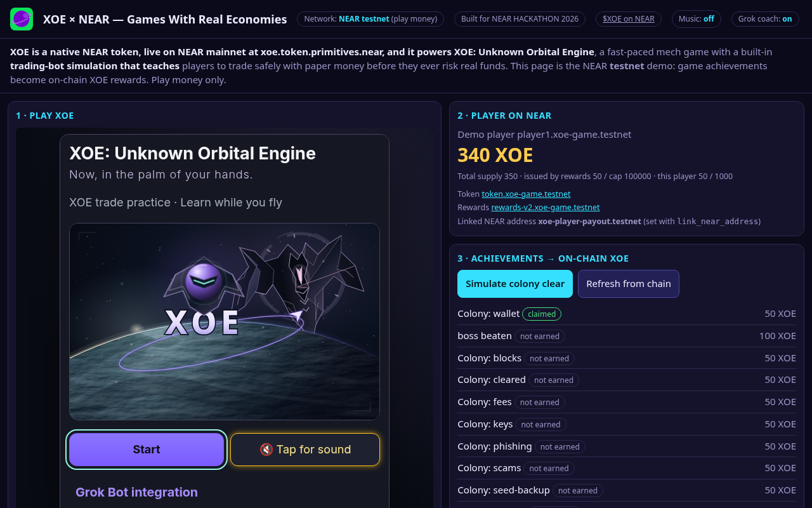

<p align="center"></p>

# XOE: Unknown Orbital Engine on NEAR

> **Built for NEAR HACKATHON 2026** · Track: **Games With Real Economies** · Network: **NEAR testnet** (play money)

**XOE is a native NEAR token, live on NEAR mainnet at `xoe.token.primitives.near`, and it powers XOE: Unknown Orbital Engine, a fast-paced mech game with a built-in trading-bot simulation that teaches players how to trade safely with paper money before they ever risk real funds.**

<p align="center">

</p>

## The story is already written
XOE is not a bare demo: it already has an in-depth storyline, playable from the first tap. You pilot XO's mech (the companion calls itself "XOE, Unknown Orbital Engine") across **10 colonies in three chapters**, each a lesson in wallets, keys, fees, scams and phishing. The truth lands soft: you are the key, and every lock you cleared was waiting for you. The keys open a special vault, XO's creation site, and XO gains flight to space and the moons. You choose **Sol or Xelm** and fly toward the **Ragnarok gate**, while a monumental spiritual-mechanical entity approaches the planet. Grok is woven into the narrative, guiding the pilot, and also runs the trading coach (see below). The moons have their own scenes (Xelm aurora and frost spires, Sol blazing horizon and embers).

## Hard rules (locked by the builder)
1. XOE ticker numbers in the trading sim are simulated and user-generated: no dollar signs, just numbers representing the XOE ticker.
2. RSI and EMA are integrated into the simulator, computed from the simulated prices, and the coach calls signals off them.
3. The demo video shows real gameplay: mech, trading desk, coach tip, chart timeframes, ending on the NEAR testnet claim, with the synth track.
4. All prior locked items remain: coin picture, storyline mention, native NEAR token line, NEAR commitment closing line, all chart timeframes (1m through monthly), music button on the demo page.

## The problem
New traders learn by losing real money, and most "learn to trade" apps are boring. XOE teaches trading and wallet safety
(wallets, keys, fees, scams, phishing, seed backup, leverage, stop-loss and take-profit) inside an arcade mech game. A
practice trading desk uses **paper money only**. A real game economy needs rewards that players actually own, so XOE
mints a testnet XOE token on NEAR when a player earns an achievement.

## What it is
| Part | What it does | Where |
|---|---|---|
| **XOE game** | Phone and desktop mech game (Vite + TypeScript, single-file HTML/PWA). 10 story colonies, boss fights, a moon choice, and a **trading-bot simulation desk** (order book, market/limit/stop orders, SL/TP, trailing stop, price alerts, P/L journal, risk-based sizing, coach tips). All trading is simulated paper money. | `game/` |
| **XOE token** (NEAR) | NEP-141 fungible token with NEP-145 storage and NEP-148 metadata. Only the rewards contract may mint. Optional hard max supply. | `contracts/contracts/xoe-token` |
| **XOE rewards** (NEAR) | Reward table, per-player and global caps, one claim per achievement, pause switch, attester-only `attest`, `claim` mints through the token with a rollback callback if the mint fails. Players can link one NEAR address (validated as a NEAR account id) to receive their XOE. | `contracts/contracts/xoe-rewards` |
| **Demo page + server** | Embeds the game, listens for the game's achievement event, has the attester account record it on-chain with `near-api-js`, and lets the demo player claim and see their XOE balance change on testnet. | `demo/` |

### The live token
XOE is a **native NEAR token**: **[xoe.token.primitives.near](https://nearblocks.io/token/xoe.token.primitives.near)** on NEAR mainnet (owner `xoe-official.near`, 1,000,000,000 supply, 18 decimals).
Players claim XOE straight from the game, with no vault, and link a NEAR address to receive it. **The demo in this repo runs on NEAR testnet**
(`token.xoe-game.testnet` and `rewards-v2.xoe-game.testnet`, a separate play-money token with no value). The direct no-vault mainnet claim is the next build step.
Nothing here is financial advice or a price or market claim, and the demo touches no mainnet funds.

> **Win or lose, XOE is building on NEAR. That was the plan before we ever heard about this hackathon, and it stays the plan after.**

## NEAR tech used
* **NEAR testnet**, contracts written in Rust with **near-sdk-rs 5.30** and **near-contract-standards**: **NEP-141** (token), **NEP-145** (storage), **NEP-148** (metadata).
* **Cross-contract calls with callbacks**: `rewards.claim` → `token.ft_mint` → `on_claim_mint` (state rolls back if the mint fails).
* **near-api-js 6**: the demo server signs `attest` (attester account) and `claim` (demo player account) and reads views over RPC.
* **near-sandbox + near-api** integration tests (local NEAR node), **cargo-near** builds.
* Native NEAR token design: players link a NEAR address and claim XOE straight from the game with no vault and no bridge. The direct mainnet claim is the next build step.

## Live testnet contracts
| | Account |
|---|---|
| XOE token | [`token.xoe-game.testnet`](https://testnet.nearblocks.io/address/token.xoe-game.testnet) |
| Rewards | [`rewards-v2.xoe-game.testnet`](https://testnet.nearblocks.io/address/rewards-v2.xoe-game.testnet) |
| Attester (game server role) | [`attester.xoe-game.testnet`](https://testnet.nearblocks.io/address/attester.xoe-game.testnet) |
| Demo player | [`player1.xoe-game.testnet`](https://testnet.nearblocks.io/address/player1.xoe-game.testnet) |

Transactions and config: [`docs/TESTNET.md`](docs/TESTNET.md).

## Grok AI coach
The trade desk's coach tip is rule-based by default. When the game runs inside the demo page **and** the demo server has an xAI key, the tip is answered by **Grok** instead (label **"Grok Bot coach (sim)"**).
* **How:** after a trading decision (open or close, stop or size change, order-form plan), the game posts a small context (side, size, entry, SL/TP, risk %, P/L %, last result) to the demo page with `postMessage`. The page calls `POST /api/coach` on the demo server, which calls `https://api.x.ai/v1/chat/completions` (default model `grok-4.20-0309-non-reasoning`, override with `XAI_MODEL`) with a short in-universe coach prompt: 1-2 sentences about risk, sizing and stops, paper money only, never financial advice. 6 s timeout, 280-character cap, 12 requests/minute limit.
* **Key safety:** the key is read only from `process.env.XAI_API_KEY` on the server. It is never in the game HTML, the repo or any response. The game itself makes no network call for the coach.
* **Fallback:** no key, timeout, error, rate limit, bad reply, or opening the game standalone (`file://`) all keep the rule-based tip, instantly. The demo never breaks.
* **Try it:** `cd demo && XAI_API_KEY=<your key> npm start`, open `http://127.0.0.1:4400`, press **XOE trade desk** in the game, wait a second. → The coach box switches to "Grok Bot coach (sim)" and the page pill says "Grok coach: on". Without the key → rule-based tip and "Grok coach: off".
* **Test without a key:** `cd demo && npm test` (10 server tests, mocked fetch) and `npm run test:e2e-coach` (real game build through a mock xAI server, both key and no-key cases); `cd game && npx vitest run src/game/grok-coach.test.ts`.

### RSI and EMA signals (sim)
The paper desk chart shows **EMA 9, EMA 21, VWAP and an RSI (14) pane with 70 / 30 lines**, all computed from the simulated XOE prices on the **selected timeframe** (1m to 1M). Ticker, desk and coach show plain numbers, no dollar signs. The coach (rule-based, and the Grok context) reads RSI and EMA and calls signals in sim terms, for example: "RSI 28, oversold, price back above EMA 9 on 5m: possible long (sim)." It is a practice read of simulated prices, not advice, and it never places orders. The sim price is deliberately calm around its anchor, so RSI usually sits near the middle and a live 70 / 30 signal is uncommon; unit tests cover every signal case.

## How the economy works
```
play XOE ──win──▶ game emits "xoe:achievement" ──▶ attester account: rewards.attest(player, achievement)
                                                           │
player account: rewards.claim(achievement) ◀──────────────┘
       └─▶ token.ft_mint(player, amount)  (rewards contract is the only minter)
```
Rewards (placeholders): 50 XOE per colony (10 colonies), 100 XOE boss, 200 XOE game finished. One claim per achievement,
1,000 XOE per player and 100,000 XOE total issuance caps, owner pause switch.

## For judges: do X, see Y
**A. See it live on NEAR testnet (no keys, 1 minute).**
1. Run `cd demo && npm install && npm run state`. → You see token supply, caps, the reward table and the demo player's XOE balance, read straight from testnet RPC.
2. Open `https://testnet.nearblocks.io/address/token.xoe-game.testnet`. → See `ft_mint` receipts called by `rewards-v2.xoe-game.testnet` and the `XOE` token holders.
3. Watch `media/demo-flow.mp4` (about 20 s). → A colony reward is attested, claimed, and the balance goes up.

**B. Run the contract tests (local NEAR sandbox, ~3 minutes, no keys).**
1. Install Rust 1.95 (pinned in `contracts/rust-toolchain.toml`) with the `wasm32-unknown-unknown` target, plus `cargo-near`.
2. `cd contracts && bash scripts/test.sh`. → **32 tests pass**: 29 unit tests and 3 sandbox integration tests covering NEAR address link rules, attest/claim/caps/pause and mint-failure rollback.

**C. Run the whole demo yourself (needs testnet keys, see below).**
1. `cd game && npm install && bash scripts/build-v19.sh` (builds `game/dist`).
2. `cd demo && npm install && npm start`, open `http://127.0.0.1:4400`. → Game on the left, live NEAR panel on the right.
3. Press **Simulate colony clear** (or clear a colony in the game). → The attester sends `attest` to testnet; the row shows **attested** with a link to the transaction.
4. Press **Claim 50 XOE**. → `claim` runs, the token contract mints, the balance rises by 50 XOE, and the transaction link opens on nearblocks.
5. Without keys the page still loads in read-only mode with live chain state.

**Your own deployment:** create a free testnet account, put its key in `~/.near-credentials/testnet/<name>.json`,
build (`bash contracts/scripts/build.sh`), then `node demo/scripts/deploy-testnet.mjs <name>.testnet --send`, edit `demo/config.json`.
*(The deploy script is untested end-to-end; the live deployment above was made earlier with near-cli-rs using the same calls.)*

**D. Play the game.** `game/dist/index.html` runs standalone in any browser. Tap **Start**, follow the tutorial, and use the practice desk (paper money, labelled SIM).

## Verification
* Game: `cd game && npm install && npm run typecheck && npm test` → **500 unit tests pass**; `npm run build`, `npm run test:full` (fresh 10-colony playthrough on desktop, phone portrait and landscape with axe accessibility checks), `node review-near-hook.mjs` (the real game emits the achievement event on a colony clear).
* Contracts: `cd contracts && bash scripts/test.sh` → 32 passed.
* Demo server: `cd demo && npm test` → 10 passed (Grok coach endpoint, mocked fetch, indicator fields).

## Screenshots and video
`media/chart-timeframes-portrait-4h.png`, `chart-timeframes-landscape-1W.png` and `chart-timeframes-desktop-1M.png` (paper-desk chart timeframes 1m, 5m, 15m, 30m, 1h, 4h, 1D, 1W, 1M), `media/demo-page-phone-music.png`, `media/desktop-1-start.png`, `desktop-2-attested.png`, `desktop-3-claimed.png`, `phone-1-demo-top.png`, `phone-2-demo-chain.png`, `phone-3-game.png`, `media/demo-flow.mp4` (silent) and `media/demo-flow-music.mp4` (65 s real-footage video: mech gameplay, paper desk with RSI/EMA and the coach, chart timeframes, NEAR testnet claim, with the original theme; the first 21 s demo-flow cut is kept as `media/demo-flow-music-v1.mp4`). Rebuild it with `demo/scripts/capture-video.mjs` (Playwright recording of the live game and demo page) and `demo/scripts/assemble-video.sh` (ffmpeg).

Music: the original XOE theme, synthesised entirely by code in [`music/make-theme.py`](music/make-theme.py) (no samples, no third-party music): [`media/xoe-theme.mp3`](media/xoe-theme.mp3) / [`.ogg`](media/xoe-theme.ogg), 38 s seamless loop, dark and energetic space-cyber mood, about -16 LUFS. The demo page has a **Music: off/on** toggle (off by default, never autoplays). Demo video with the theme: [`media/demo-flow-music.mp4`](media/demo-flow-music.mp4) (65 s, 1280x720).

## What existed before the hackathon vs. what was built for it (disclosure)
* **Baseline (before):** the XOE game in `game/` (mech game, lessons, paper-money trading desk, PWA) was built before this hackathon, with paper ledgers and no NEAR code. It is tagged `pre-hackathon`.
* **Built for the hackathon (the NEAR integration):** everything in `contracts/` (NEP-141 token, rewards contract, tests, docs), everything in `demo/`, `docs/`, `media/`, and one small game change, `game/src/game/near-hook.ts` plus two call sites in `game/src/App.tsx` that announce achievements, with tests and `game/review-near-hook.mjs`. Tag: `hackathon-submission`.
* See the diff: `git diff pre-hackathon hackathon-submission --stat` (or the compare view on GitHub: `/compare/pre-hackathon...hackathon-submission`).
* Libraries: near-sdk, near-contract-standards, near-api-js, Preact/Vite, Playwright, vitest (all listed in the lock files). AI coding assistance was used.

## Honest limits (this is a prototype)
* **Testnet only.** The XOE token here has no value. It is separate from the live mainnet XOE token (`xoe.token.primitives.near`); the demo is not connected to it.
* The demo uses a **server-held testnet key for the attester and the demo player** so judges can see the flow without a wallet. A real launch needs a wallet connection (NEAR wallet-selector) so players sign their own claims, a protected attester key, and server-side anti-cheat.
* The game's **trade desk is paper money only** and the game's own local reward ledger is unchanged. The NEAR rewards are an added layer fed by achievement events.
* Amounts, caps and supply are **placeholders**. No audit has been done. NEAR address ownership is not proven yet.
* Built with AI coding assistance. The `game/` folder is a snapshot of the current XOE v19 build.

## Repo layout
```
game/       XOE game source (Vite/TypeScript); src/game/near-hook.ts is the only NEAR-facing change
contracts/  Rust workspace: xoe-token, xoe-rewards, wnear-mock (legacy helper), sandbox integration tests, docs/BRIDGE_OPTIONS.md (superseded note)
demo/       Demo page, near-api-js server, scripts (state, demo-run, setup-rewards, deploy-testnet, capture)
docs/       TESTNET.md (accounts and transactions)
media/      screenshots, demo videos, coin logo, original theme (mp3/ogg)
music/      make-theme.py (code-synthesised theme) and build.sh
```
