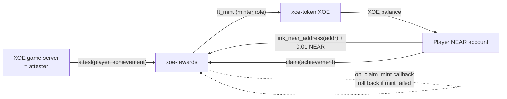

# XOE rewards on NEAR (NEP-141 token + rewards contract)

Contracts for the NEAR HACKATHON 2026 entry. The demo contracts are **deployed to NEAR TESTNET only**
(play money, no real funds). The real XOE token is separate: a native NEAR token on mainnet at
`xoe.token.primitives.near`. The sandbox tests below run on a throwaway local NEAR node. Live testnet
accounts and how they are used are in the repo root `README.md`. The addresses used in tests are made up.
Reward amounts and caps are placeholders until the final tokenomics are decided.

Built 11 Nov 2026, around 6:20 PM CST (America/Indiana/Knox), with near-sdk-rs 5.30.1.

## What it does, in plain English

XOE is a **native NEAR token** (mainnet: `xoe.token.primitives.near`). The contracts here are the
testnet demo of how players earn it from the game.

1. A player links **one** NEAR address (their payout address) to their NEAR account, and that
   address can't be linked to anyone else.
2. When the player beats something in the game, the **game server** (the "attester") tells the
   contract "player X earned achievement Y".
3. The player presses **Claim**. The rewards contract checks it hasn't been claimed, checks the
   caps, and asks the XOE token contract to mint the reward. No vault holds the tokens.
4. Today the demo claim mints to the claiming account on testnet. Paying out directly to the linked
   NEAR address on mainnet is the next build step.

## Contracts

| Folder | What it is |
|---|---|
| `contracts/xoe-token` | XOE token. NEP-141 + NEP-145 storage + NEP-148 metadata. Symbol `XOE`, name `Unknown Orbital Engine`, 18 decimals. Owner adds/removes **minters**. Optional hard `max_supply`. |
| `contracts/xoe-rewards` | Reward table, per-player cap, global cap, one claim per achievement, pause/unpause, NEAR address link (validated as a NEAR account id), attester-only attest, claim mints via the token. Rolls a claim back if the mint fails. |
| `contracts/wnear-mock` | Legacy test helper from an earlier design. Not used by the rewards contract or the integration tests any more. |
| `integration-tests` | Sandbox tests that deploy token + rewards to a local node. |
| `docs/BRIDGE_OPTIONS.md` | Superseded note: XOE is native NEAR, nothing to bridge. |



## Main methods

* Token: `new_default_meta(owner_id, max_supply?)`, `add_minter`, `remove_minter` (owner, 1 yocto),
  `ft_mint(account_id, amount, memo?)` (minters only), plus standard `ft_*` / `storage_*`.
* Rewards: `new(owner_id, attester_id, token_id, per_player_cap, global_cap)`;
  owner (1 yocto): `set_reward`, `remove_reward`, `set_caps`, `set_attester`, `set_owner`,
  `pause`, `unpause`;
  player: `link_near_address` (0.01 NEAR), `claim` (give it ~100 Tgas);
  attester: `attest`; views: `get_config`, `list_rewards`, `get_near_address`,
  `get_near_account`, `check_near_address`, `is_attested`, `is_claimed`, `get_player_issued`.

Pause blocks linking, attesting and claiming.

**Deployed testnet contract:** `rewards-v2.xoe-game.testnet` runs this code (`link_near_address`, `attest`, `claim`). It replaced `rewards.xoe-game.testnet`, whose stored state layout was incompatible. The old account is retired and is no longer a minter on the testnet token.

## How to run

```bash
cd contracts
./scripts/test.sh     # unit tests + sandbox tests (about 1.5 min)
./scripts/build.sh    # wasm for all contracts + SHA-256 into wasm-sha256.txt
```

Needs the toolchain from `/workspace/xeno-near/SETUP.md` (Rust 1.95 pinned, wasm32 target,
cargo-near, `OPENSSL_NO_VENDOR=1`; the scripts set PATH and that variable).

The sandbox tests use `near-sandbox` + `near-api` (what `cargo near new` uses today) rather than
the older `near-workspaces` crate. Same idea: a real local NEAR node.

## Test results (13 Nov 2026, NEAR-native rebrand)

* xoe-token unit: **7 passed**
* xoe-rewards unit: **20 passed**
* wnear-mock unit: **2 passed** (legacy helper, no longer used by the other contracts)
* Sandbox integration: **3 passed** (`link_rules`, `attest_claim_caps_pause`, `failed_mint_rolls_back_claim`)
* **32 / 32 passed, 0 failed** (the 11 Nov run had 36; the bridge-mock tests were removed with the bridge)

Covered: link, invalid NEAR address, both duplicate-link directions, missing deposit,
non-attester (player and stranger), unknown achievement, unlinked player, claim before attest,
attest + claim mints, double claim, double attest, per-player cap, global cap, pause/unpause,
non-owner admin, non-minter mint, failed-mint rollback and retry.

Wasm hashes from the 11 Nov build are no longer valid for `xoe-rewards` (the contract changed).
Run `./scripts/build.sh` for current hashes. Builds are non-reproducible; use a reproducible build before any launch.

## Real vs placeholder

| Piece | Status |
|---|---|
| XOE token on NEAR mainnet | Live at `xoe.token.primitives.near` (owner `xoe-official.near`). Not managed by this repo |
| XOE token logic, minter role, caps, claims, NEAR link checks | Real contract code, tested on a local node and deployed to testnet only (testnet has the older link methods) |
| Accounts (`owner.sandbox`, `player1.sandbox`, ...) | Made up, exist only in the local node |
| NEAR payout addresses in tests | Made up (`payout-a.near` etc.), not anyone's wallet |
| Game attester | A sandbox account. No real game server, no signed proofs from gameplay |
| Direct mainnet claim | Not built yet. This is the next build step |
| Linking proof | Not real: a player can link any valid NEAR account id. They don't prove they control it yet |

## Known limits (prototype)

* **Anti-cheat:** the contract believes the attester. Anyone holding the attester key can award
  achievements up to the caps. Real launch needs server-side checks, rate limits, and a protected key.
* **Payout address ownership isn't proven.** The link only checks that the text is a valid NEAR account id.
  Before paying out to a linked address, require a signature or a call from that account.
* Claims mint to the claiming account today, not yet to the linked address.
* Reward amounts and caps in tests are placeholders. No audit has been done.

## Checklist before any real launch

- [ ] **Eddie decides tokenomics:** reward amount per achievement, per-player and global caps, how
      rewards relate to the existing mainnet supply and whether XOE has any market value.
- [ ] **Legal / securities review** of a reward token with value.
- [ ] **Security audit** of all contracts (plus fuzzing and upgrade/ownership plan, ideally multisig owner).
- [ ] **Attester key management:** key in an HSM/KMS, rotation plan, limited-access key, monitoring, alerts.
- [ ] **Anti-cheat** on the game server; signed, verifiable achievement proofs if possible.
- [ ] **Direct no-vault mainnet claim** and proof of control of the linked NEAR address.
- [ ] Reproducible wasm builds and published source.
- [ ] **Testnet redeploy of the renamed rewards contract, only with Eddie's OK**, then a testnet run, then mainnet only after all of the above.
- [ ] Keep the game's paper/sim labels until real rewards are approved and live.
